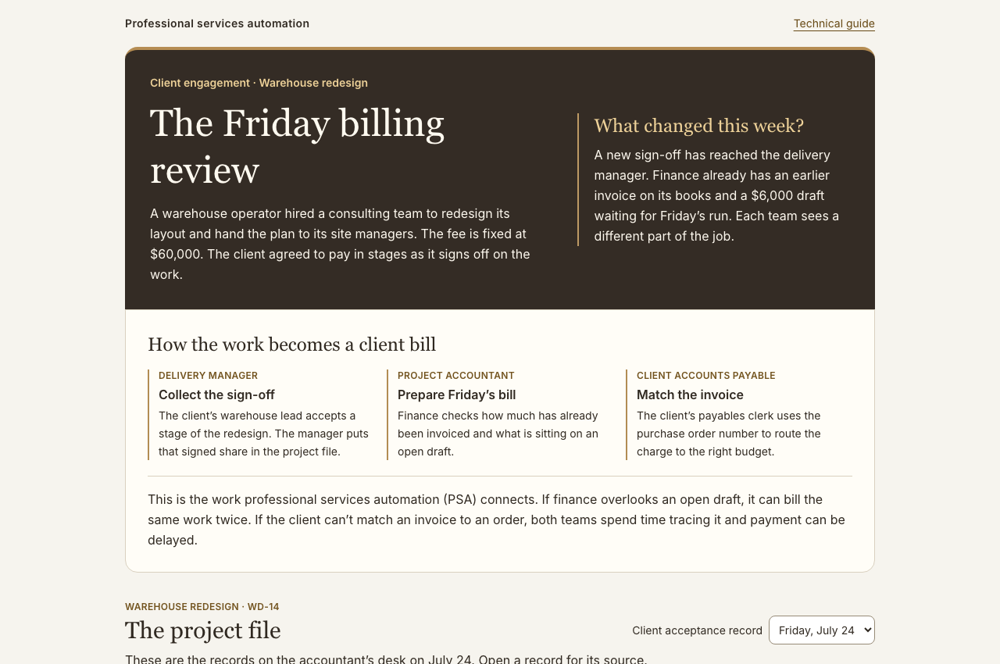

# Consulting realization kernel

[](https://github.com/SafetyMP/Professional-Service-Automation/actions/workflows/ci.yml)
[](LICENSE)
[](https://nodejs.org/)

Approved consulting time becomes utilization, WIP dollars, a draft milestone or contract invoice, and project margin. A draft invoice does not consume WIP; time and expenses stay unbilled until the invoice is issued.

> **Permit rule:** Realization numbers come from approved time, WIP, and contracts — not from a model. Humans operate this kernel. Same instinct: [SafetyMP](https://github.com/SafetyMP/SafetyMP).

## Try the Friday billing review

A consulting team promised a $60,000 warehouse redesign, billed as the client signs off on the work. A new sign-off has reached the delivery manager. The project accountant has $6,000 on an open draft. The client’s payables clerk needs an invoice they can match to the order.

Inspect the order, the signed progress and the invoice register. Try issuing, holding or voiding the same draft on the same Friday. The case compares where the money sits and who has work to do next. The optional pilot worksheet compares two monthly closes using a spreadsheet, a draft register or the billing kernel. The records and planning assumptions are illustrative. [Try the standalone demo](https://raw.githack.com/SafetyMP/SafetyMP/30a6bb848cd29f30183e37206587366b98dbf6d7/docs/review-builds/Professional-Service-Automation/index.html) (select **Open the page** if prompted) · [Open the case in your local app](http://localhost:3005/case).

The technical guide carries the chosen date and decision from source records to billing calculations and the corresponding database operation. Open “Compare recorded runs” to check the selected ledger against the reproducible July 31 trials. The study and guide run without sign-in or a database. [Explore the guide with the July 31 issue decision selected](http://localhost:3005/case/technical?progress=50&treatment=issue&trial=voided#selected).

[](https://raw.githack.com/SafetyMP/SafetyMP/30a6bb848cd29f30183e37206587366b98dbf6d7/docs/review-builds/Professional-Service-Automation/index.html)

### From signed work to a billing transaction

1. **Read the project file.** The case pairs dated client sign-offs with an issued invoice and an open draft. The accountant selects Friday’s records and checks the purchase order. In the connected application, an administrator enters progress. [Case records and selection](src/app/case/selection.ts) · [Progress entry](src/app/actions.ts)
2. **Count committed value.** The kernel applies the accepted percentage to the fixed fee and deducts issued invoices and reserved drafts. Run `npx tsx scripts/record-billing-case.ts --check` after installing dependencies to verify the recorded issue and void trials against those functions. [Progress calculation](lib/billing/contract-billing.ts) · [Invoice status totals](lib/billing/realization.ts) · [Trial generator](scripts/record-billing-case.ts)
3. **Follow the write.** The guide shows the modeled ledger for a hold, issue or void. In the signed-in application, the billing service issues or deletes an open draft inside the organization’s database transaction. Holding leaves the reservation in place. The accountant still checks the client reference, and payment requires separate evidence. [Technical guide](src/app/case/technical/selected-trace.tsx) · [Billing service](lib/billing/service.ts)

## Why not Kimai

- **Kimai is a time tracker.** Hours, approvals, and timesheets are its product.
- **This repo is realization.** Approved time becomes utilization, WIP dollars, a draft milestone or contract invoice, and project margin.
- **Postgres RLS is the tenancy model.** Organization isolation is enforced in the database, not only in application middleware.

## Features

- **Multi-tenant organizations** with role-based access (Admin, Manager, Consultant)
- **Clients & projects** — tasks, team members, budgets, billing models (T&M, fixed fee, retainer, milestone)
- **Time & expenses** — approval workflows, categories, receipt uploads, bulk approval
- **Resources** — profiles, allocations, utilization reporting
- **Billing** — WIP and contract/progress invoicing, milestone billing, PDF export, journal CSV
- **Accounting** — chart of accounts, Xero / QuickBooks OAuth, push journals from invoices
- **Reporting** — profitability with contract/milestone columns, expense breakdown by category
- **Row-level security** — PostgreSQL RLS enforces organization isolation

## Stack

- [Next.js 16](https://nextjs.org/) (App Router) · [React 19](https://react.dev/) · [TypeScript 6](https://www.typescriptlang.org/)
- [PostgreSQL 16](https://www.postgresql.org/) · [Prisma 7](https://www.prisma.io/) · [Auth.js / NextAuth v5](https://authjs.dev/)
- [Tailwind CSS 4](https://tailwindcss.com/) · [Vitest](https://vitest.dev/)

## Prerequisites

- Node.js 22+ (see [`.nvmrc`](.nvmrc))
- Docker (for local Postgres) or an existing PostgreSQL 16 instance
- npm

The realization CLI also runs without Postgres. It shows how a draft holds approved time as unbilled WIP, how issue marks it invoiced, and how voiding a draft releases the hold.

```bash
npm install
npm run realize
```

## Quick start

```bash
git clone https://github.com/SafetyMP/Professional-Service-Automation.git
cd Professional-Service-Automation

cp .env.example .env
# Edit .env: set AUTH_SECRET (e.g. openssl rand -base64 32)

docker compose up -d

npm install
npm run db:migrate
npm run db:seed

npm run dev -- -p 3005
# http://localhost:3005
```

### Seeded workspace accounts

| Field | Value |
|-------|-------|
| Organization | `demo-firm` |
| Admin | `admin@demo.com` / `password123` |
| Manager | `manager@demo.com` / `password123` |

**Do not use demo credentials in production.** Change passwords and rotate `AUTH_SECRET` before deploying.

## Environment variables

See [`.env.example`](.env.example):

| Variable | Purpose |
|----------|---------|
| `DATABASE_URL` | App database URL (RLS role `psa_app`) |
| `DIRECT_URL` | Direct Postgres URL for migrations (`postgres` superuser) |
| `AUTH_SECRET` | Session signing secret (required) |
| `AUTH_URL` | Public app URL (e.g. `http://localhost:3005`) |
| `XERO_CLIENT_ID` / `XERO_CLIENT_SECRET` | Optional — Xero OAuth |
| `QUICKBOOKS_CLIENT_ID` / `QUICKBOOKS_CLIENT_SECRET` | Optional — QuickBooks OAuth |
| `QUICKBOOKS_ENV` | `sandbox` (default) or `production` |

Local Docker Postgres listens on **port 5440** (mapped from container 5432).

## Deploy

For production or a one-command demo stack (Postgres + app in Docker):

```bash
export AUTH_SECRET="$(openssl rand -base64 32)"
docker compose -f docker-compose.stack.yml up --build -d
# http://localhost:3000 — demo-firm / admin@demo.com / password123
```

See [`docs/deploy.md`](docs/deploy.md) for Railway, Fly.io, manual Node deployment, and the production checklist.

## Scripts

| Command | Description |
|---------|-------------|
| `npm run dev` | Prisma generate + Next.js dev server |
| `npm run build` | Production build |
| `npm run lint` | ESLint |
| `npm run typecheck` | TypeScript check |
| `npm run test` | Vitest unit tests |
| `npm run realize` | Draft holds WIP; issue realizes it; void refuses an issued invoice |
| `npm run tenancy` | `psa_app` sees no password hashes until an org or login email is set |
| `npm run db:migrate` | Apply Prisma migrations |
| `npm run db:seed` | Reset and seed demo data |
| `npm run check:boundaries` | Module import boundary lint |
| `./scripts/verify.sh` | Full local verification gate |
| `npm run screenshots` | Capture installed workspace screenshots and GIF (requires running server) |

## Project layout

```
lib/           Domain services (clients, projects, time, billing, …)
src/app/       Next.js App Router pages and API routes
prisma/        Schema, migrations, RLS policies
specs/         Domain rules and product scope
tests/         Unit tests
scripts/       Seed, verify, boundary checks
```

Domain logic lives in `lib/<domain>/service.ts`. Cross-domain imports must go through public service files only (enforced by `scripts/check-boundaries.ts`).

## Contributing

Contributions are welcome. See [CONTRIBUTING.md](CONTRIBUTING.md) for setup, conventions, and the pull request checklist.

- [Q&A Discussions](https://github.com/SafetyMP/Professional-Service-Automation/discussions/categories/q-a)
- [Bug reports](.github/ISSUE_TEMPLATE/bug_report.yml)
- [Feature requests](.github/ISSUE_TEMPLATE/feature_request.yml)
- [Code of Conduct](CODE_OF_CONDUCT.md)

## Roadmap

Phase 1 (v0.1.x) and Phase 2 (v0.2.0 – v0.5.0) are shipped. Scope is in [`specs/product/mvp-scope.md`](specs/product/mvp-scope.md). Phase 3+ (tax, retainer auto-draft, client portal, approval email, public API, native mobile) is out of scope.

Release history: [CHANGELOG.md](CHANGELOG.md).

## CI

GitHub Actions on every push and pull request:

| Workflow | Purpose |
|----------|---------|
| [CI](.github/workflows/ci.yml) | Lint, typecheck, unit tests, boundaries, Prisma validate, production build, **E2E smoke tests** |
| [CodeQL](.github/workflows/codeql.yml) | Security analysis (weekly + on PR) |
| [Release](.github/workflows/release.yml) | Publish Docker image to GHCR on release |
| [Screenshots](.github/workflows/screenshots.yml) | Capture the installed workspace on release |

Dependabot opens weekly PRs for npm, GitHub Actions, and Docker base images.

Local E2E: `npm run test:e2e` (requires running server + seeded DB on port 3005).

## Documentation

- [`docs/DESIGN-PIVOT.md`](docs/DESIGN-PIVOT.md) — realization-kernel positioning (why not Kimai / generic PSA)
- [`docs/deploy.md`](docs/deploy.md) — Docker, Railway, Fly.io, and production checklist
- [`docs/development.md`](docs/development.md) — local setup, architecture, testing, and common tasks
- [`AGENTS.md`](AGENTS.md) — community agent/developer contract
- [`docs/factory-overlay.md`](docs/factory-overlay.md) — factory/site overlay (moved out of root AGENTS.md)
- [`specs/domain/billing-rules.md`](specs/domain/billing-rules.md) — billing model rules
- [`specs/domain/profitability-rules.md`](specs/domain/profitability-rules.md) — profitability calculations

## Security

See [`SECURITY.md`](SECURITY.md) for reporting vulnerabilities.

## License

[Apache License 2.0](LICENSE)


## Documentation map

[docs/README.md](docs/README.md) lists the repository layout. Community policy files are the root `CONTRIBUTING.md`, `CODE_OF_CONDUCT.md`, and `SECURITY.md`.
